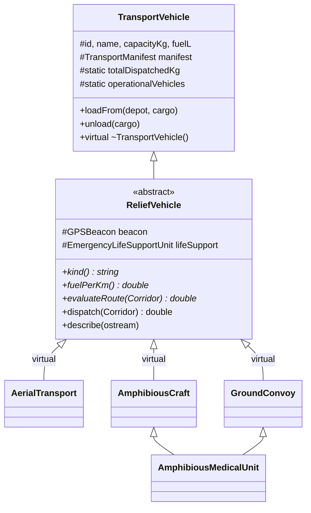

# ERL-HUB: Post-Earthquake Multi-Agency Emergency Relief Logistics Hub

**Course:** Object-Oriented Programming (CIC-211)
**Language:** C++
**Submitted by:**

| Name | Enrollment No. | Section |
|---|---|---|
| Ashish Omm | 03196402725 | C-20 |
| Ekamjot Singh | 00396402725 | C-19 |

---

## 1. Project Overview

After a major earthquake, relief agencies (national disaster response forces, paramilitary convoys, medical teams) must move limited supplies such as rations, trauma medicine, clean water tanks and thermal blankets across damaged infrastructure using very different vehicles: helicopters, all-terrain trucks, and amphibious boats.

**ERL-HUB** is a C++ simulation of the logistics hub that coordinates this. It models:

- **Depots** that hold stock and can be locked by blocked access roads.
- **Cargo lots** with weight, volume and a priority level (1 = low, 5 = critical).
- **Transport manifests** listing what each vehicle carries.
- **A heterogeneous fleet** where each vehicle type handles damaged corridors, fuel and payload differently.
- **Failure handling** for overweight loads, fuel shortages, impassable roads and locked depots.
- **Persistence** of transit logs and manifest audit records to binary files.
- **Prioritised dispatch** that serves medical and critical needs first.

The program is a self-running demonstration: `main()` walks through every feature and prints the results, so there is no input to type.

---

## 2. Build and Run

Requires a compiler with C++17 support (g++ 8+, clang 7+, or MSVC 2019+).

```bash
g++ -std=c++17 -Wall -Wextra -o erl_hub main.cpp
./erl_hub            # Windows: erl_hub.exe
```

Running it creates two binary files in the working directory: `audit_manifests.bin` and `transit_logs.bin`. These are the saved audit records and can be deleted safely.

---

## 3. Project Structure

```
erl_hub/
├── main.cpp     all classes, templates and the demonstration driver
└── README.md    this file
```

Inside `main.cpp` the code is organised in this order:

| Section | Contents |
|---|---|
| Shared basics (`ReliefOps`) | `Point`, inline utilities, the exception classes |
| `ReliefOps::Inventory` | `CargoItem`, `TransportManifest`, `DistributionDepot`, I/O manipulators, binary helpers |
| `ReliefOps::Logistics` | allocation functions, `TransportVehicle`, vehicle hierarchy, `IncidentCommander`, `PersistenceManager`, `PriorityDispatchQueue<T>` |
| Driver | `main()` demonstrating each unit in sequence |

---

## 4. Class Design

### 4.1 Vehicle hierarchy (Unit III)



`AmphibiousMedicalUnit` is a hybrid of `AmphibiousCraft` and `GroundConvoy`. Both inherit **virtually** from `ReliefVehicle`, so the medical unit contains exactly one `ReliefVehicle` (one fuel tank, one manifest, one GPS beacon) instead of two. This solves the diamond ambiguity. Because both parents override the pure virtual functions, the medical unit supplies its own final overriders (`kind`, `fuelPerKm`, `evaluateRoute`).

### 4.2 Vehicle behaviour

| Vehicle | Fuel use | Speed | Route rules |
|---|---|---|---|
| `AerialTransport` | 4.5 L/km | 240 km/h | Can fly over any corridor |
| `GroundConvoy` | 0.6 L/km | 55 km/h | Throws `DamagedCorridorException` if the road is damaged |
| `AmphibiousCraft` | 0.9 L/km | 50 km/h on road, 30 km/h flooded | Passes a damaged road only if it is flooded |
| `AmphibiousMedicalUnit` | 1.1 L/km | amphibious time x 1.2 | Same rules as amphibious, slower due to medical equipment |

### 4.3 Composition instead of deep inheritance

`GPSBeacon` and `EmergencyLifeSupportUnit` are **member objects** of `ReliefVehicle`. A vehicle *has a* beacon and *has a* life-support unit; it is not a kind of either. Each successful dispatch pings the beacon with the new position and consumes life-support oxygen hours.

### 4.4 Inventory classes

- **`CargoItem`:** one lot of supplies (lot number, name, type, quantity, unit volume, unit weight, priority). Two items are "the same cargo" when their lot numbers match.
- **`TransportManifest`:** the list of cargo on a vehicle. It owns a **dynamically allocated array** that grows as needed, with a hand-written copy constructor, copy assignment and destructor (the rule of three).
- **`DistributionDepot`:** holds stock, has a location, and can be locked.

---

## 5. Syllabus Coverage (Where to Find Each Requirement)

### Unit I: Core Foundations and Call Semantics

| Requirement | Implementation |
|---|---|
| Logical namespaces | `ReliefOps::Logistics` and `ReliefOps::Inventory` |
| Function overloading for supply allocation | `allocateSupply(CargoItem&, double)` by volume; `allocateSupply(CargoItem&, double, double)` by volume and weight; `allocateSupply(vector<CargoItem>&, int, int)` by priority triage |
| Call by reference | `allocateSupply` takes the stock entry by reference and deducts from it directly |
| Return by reference | `DistributionDepot::item(lot)` returns a reference, so `depot.item("B-400").adjust(-100)` edits the real stock |
| Inline utilities | `Point::distanceTo`, `payloadTonnes`, `travelHours`, `CargoItem::totalWeight/totalVolume` |
| Friend class override | `IncidentCommander` is a friend of `DistributionDepot` and `TransportVehicle`. It can `unlockDepot`, `emergencyRefuel` and `overrideCapacity` |

### Unit II: Encapsulation, Dynamic Memory and Operator Overloading

| Requirement | Implementation |
|---|---|
| Abstract data type classes | `CargoItem`, `DistributionDepot`, `TransportVehicle` with private/protected data and public interfaces |
| Static variables and functions | `TransportVehicle::dispatchedTonnage()` and `operationalCount()` |
| Copy constructors, dynamic allocation, destructors | `TransportManifest` (deep copy, so changing a copy never affects the original) |
| `+=` | `DistributionDepot`: restock (merges with an existing lot); `TransportManifest`: add cargo (rejects duplicate lots) |
| `-=` | `DistributionDepot`: deduct cargo for a departing vehicle (blocked if locked); `TransportManifest`: remove cargo on delivery |
| `==` | `TransportManifest`: same identity and same contents; `sharesCargoWith()` detects duplicate cargo between two manifests |
| `<<` and `>>` | `CargoItem` and `TransportManifest` support text serialization that round-trips; the manifest also prints as a table |

### Unit III: Inheritance, Containership and Polymorphism

| Requirement | Implementation |
|---|---|
| Base class with three derived classes | `ReliefVehicle` to `AerialTransport`, `GroundConvoy`, `AmphibiousCraft` |
| Virtual base classes for the diamond | `AmphibiousMedicalUnit` |
| Containership | `GPSBeacon` and `EmergencyLifeSupportUnit` held as members |
| Runtime polymorphism and virtual destructors | The fleet is a `std::vector<ReliefVehicle*>`; `dispatch()`, `describe()` and `delete` all go through the base pointer |

### Unit IV: Streams, Persistence, Exceptions and STL

| Requirement | Implementation |
|---|---|
| Custom exception framework from `std::exception` | `ReliefException` is the base; `CargoOverweightException`, `FuelDepletionException`, `DamagedCorridorException` and `AccessBarrierException` derive from it |
| Binary save and restore | `PersistenceManager` writes transit logs (fixed-size records) and manifest audit records (length-prefixed strings) using `std::fstream` in binary mode |
| Atomic file updates | Data is written to `<file>.tmp`, flushed and checked, then renamed over the real file, so a crash never leaves a half-written file |
| Generic template class with STL containers | `PriorityDispatchQueue<T, Compare>` uses `std::vector` for storage and `std::unordered_map` for fast duplicate detection |
| Functor objects | `OrderUrgency` and `CargoUrgency` decide who is served first |
| User-defined I/O manipulators | `tabular` / `serialized` (switch output mode), `colw(n)` (column width), `cargoHeader`, `rule` |

---

## 6. How the Key Features Work

### Dispatch pipeline
`ReliefVehicle::dispatch(corridor)` runs these checks in order:
1. **Weight:** the manifest weight must not exceed capacity, otherwise `CargoOverweightException`.
2. **Route:** the vehicle's own `evaluateRoute` runs (virtual call), and may throw `DamagedCorridorException`.
3. **Fuel:** fuel needed = `fuelPerKm() x distance`; if the tank is short, `FuelDepletionException`.
4. On success it burns fuel, pings the GPS beacon, consumes oxygen hours and adds the load to the static dispatched-tonnage counter.

### Safe loading
`loadFrom(depot, cargo)` checks the capacity **before** touching the depot, so a failed overweight load does not remove anything from the depot's stock.

### Priority ordering
Urgency rules used by the functors: **medical requests first, then higher priority number first, then by ID** as a tie-breaker. The queue's `pop()` always returns the most urgent entry, and `sorted()` returns a snapshot in order.

### Manifest output modes
A stream can print a manifest two ways, chosen with a manipulator:
```cpp
std::cout << Inventory::tabular   << manifest;   // human-readable table
std::cout << Inventory::serialized << manifest;  // machine-readable text
```
The serialized form looks like this and can be read back with `>>`:
```
MANIFEST MF-A 2
R-100|Ration Packs|0|100|0.01|1.2|2
M-200|Trauma Kits|1|40|0.02|2.5|5
```

---

## 7. What the Demonstration Shows

| Step | Scenario | Result |
|---|---|---|
| 1 | Restock the Alpha depot; edit stock by reference | Duplicate lot merges (2000 + 500 = 2500 rations) |
| 2 | Three overloaded allocation calls | 500 rations by volume, 125 blankets by volume and weight, 150 trauma kits by triage |
| 3 | Copy a manifest, change the copy | Original unchanged; `==` correctly reports a difference |
| 4 | Add a duplicate lot to a manifest | Rejected with an error |
| 5 | Load 10 water tanks (10,000 kg) on a helicopter | `CargoOverweightException`; depot stock untouched |
| 6 | Load from a locked depot | `AccessBarrierException`, then `IncidentCommander` unlocks it and the load succeeds |
| 7 | Truck on a collapsed highway | `DamagedCorridorException` |
| 8 | Helicopter on a 150 km route with 300 L | `FuelDepletionException` (needs 675 L); after a 500 L refuel it succeeds |
| 9 | Save and reload binary records | Restored manifests are identical to the originals; no `.tmp` file left over |
| 10 | Dispatch queue | Medical orders served first, duplicate order ID rejected |
| 11 | Delete the fleet via base pointers | Destructors run in correct order (derived classes first, then the shared base); operational vehicle count returns to 0 |
